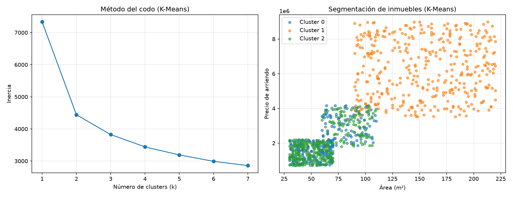

# Segmentación de Inmuebles en Arriendo con ML No Supervisado


Implementación de cuatro técnicas de Machine Learning No Supervisado (K-Means, Clustering Jerárquico, PCA y SVD) sobre un caso real de segmentación inmobiliaria, a partir del script de ejemplo del curso (`KMeansSegInmuebles.py`), modificado para trabajar sobre un dataset real de 1000 inmuebles.

> Trabajo académico — actividad **R1-A3-S12: Informe de Trabajo – ML No Supervisado**, asignatura Introducción a Machine Learning, CADI, Universidad de Cundinamarca.

[](https://colab.research.google.com/github/JoanBeltranAlt/ml-no-supervisado-inmuebles/blob/main/Segmentacion_Inmuebles_ML_No_Supervisado.ipynb)

## Tabla de contenido

- [El caso](#el-caso)
- [Contenido del repositorio](#contenido-del-repositorio)
- [Técnicas implementadas](#técnicas-implementadas)
- [Resultados](#resultados)
- [Cómo ejecutarlo](#cómo-ejecutarlo)
- [Autor](#autor)

## El caso

Una inmobiliaria administra un portafolio de 1000 inmuebles en arriendo, sin ninguna clasificación comercial previa. El objetivo es descubrir grupos naturales de inmuebles según sus características físicas (área, habitaciones, baños), económicas (precio, estrato) y geográficas (localidad), para diseñar mejores estrategias comerciales.

## Contenido del repositorio

```
.
├── Segmentacion_Inmuebles_ML_No_Supervisado.ipynb   # Notebook ejecutado (Colab)
├── DATASET_INmuebles.xlsx                           # Dataset real (1000 inmuebles)
├── kmeans_inmuebles.png                             # Método del codo + segmentación K-Means
├── dendrograma_inmuebles.png                        # Dendrograma del clustering jerárquico
├── pca_inmuebles.png                                # Proyección PCA
├── svd_inmuebles.png                                # Proyección SVD
├── resultados_segmentacion.csv                      # Dataset con clusters asignados
└── README.md
```

## Técnicas implementadas

- **K-Means**: segmentación en 3 grupos, con selección de k mediante el método del codo.
- **Clustering Jerárquico (Ward)**: dendrograma sobre una muestra de 40 inmuebles, y agrupamiento completo con `AgglomerativeClustering`.
- **PCA**: reducción de 12 dimensiones (tras preprocesamiento) a 2 componentes.
- **SVD (`TruncatedSVD`)**: reducción de dimensionalidad alternativa, comparada contra PCA.

## Resultados

- K-Means y Clustering Jerárquico coincidieron en el **91.3%** de las asignaciones de cluster, confirmando que los tres segmentos (económico, intermedio, premium) reflejan una estructura real de los datos.
- Silhouette score: **0.255** (K-Means) y **0.219** (Jerárquico).
- PCA y SVD explicaron exactamente la misma varianza acumulada (**60.29%** con 2 componentes), al ser matemáticamente equivalentes sobre datos ya centrados.

| Cluster | Área promedio | Precio promedio | Perfil |
|---|---|---|---|
| 1 | 154.6 m² | $6,300,712 | Premium |
| 0 | 61.3 m² | $2,000,101 | Económico |
| 2 | 60.7 m² | $1,967,061 | Económico |



## Cómo ejecutarlo

**Opción 1: Google Colab**

Abrir directamente con el badge de arriba, o manualmente: `Archivo → Abrir notebook → GitHub`, pegar la URL de este repositorio.

**Opción 2: Entorno local**
```bash
pip install pandas numpy matplotlib scikit-learn scipy openpyxl
jupyter notebook Segmentacion_Inmuebles_ML_No_Supervisado.ipynb
```

## Autor

**Joan Schneider Beltrán Delgado**
Especialización en Inteligencia Artificial, Universidad de Cundinamarca
